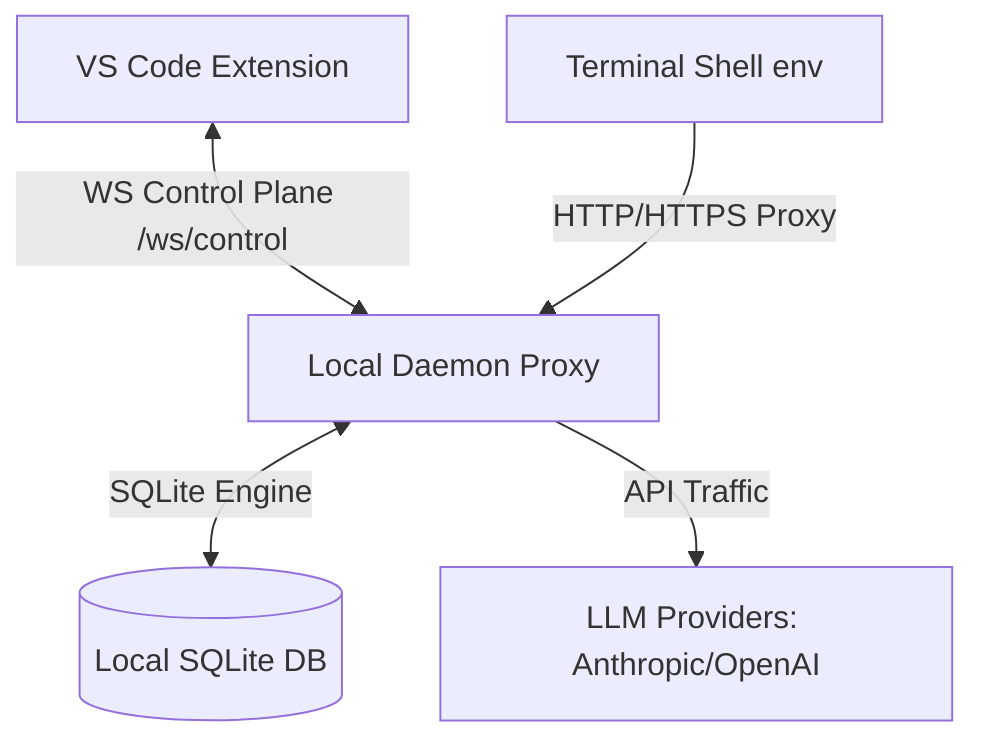
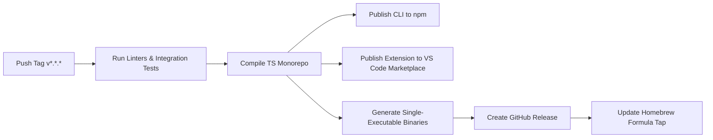
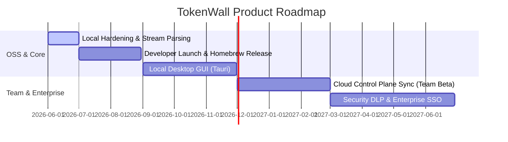

# TokenWall Productization: Packaging, Distribution, Launch & Commercialization Plan

This document outlines the strategy for packaging, distributing, launching, and commercializing **TokenWall** as it transitions from a local developer tool into a high-scale commercial startup.

---

## SECTION 1 — FINAL PRODUCT SHAPE

To achieve mass adoption and frictionless integration into developer workflows, TokenWall is structured as a multi-tier local architecture. Each layer has distinct execution responsibilities:



### 1. npm CLI Package (`@tokenwall/cli`)
* **Role**: The main CLI driver and execution client.
* **Responsibilities**:
  * Exposes subcommands for configuration (`tokenwall config`), status monitoring (`tokenwall status`), diagnostics (`tokenwall doctor`), and execution wrapping (`tokenwall exec -- <cmd>`).
  * Manages daemon lifecycle processes (start, stop, status).
* **Reference**: [cli/package.json](file:///Users/shashankkumar/Documents/tokenWall/apps/cli/package.json), [cli/src/index.ts](file:///Users/shashankkumar/Documents/tokenWall/apps/cli/src/index.ts).

### 2. Homebrew Formula (`tokenwall`)
* **Role**: Global system installation and daemon management for macOS.
* **Responsibilities**:
  * Packages compiled node binaries or single-executable binaries.
  * Registers TokenWall as a standard launchd background service (`brew services start tokenwall`), ensuring the daemon starts automatically on system boot.

### 3. VS Code Extension (`tokenwall-vscode`)
* **Role**: The primary developer interaction surface and seamless proxy configuration engine.
* **Responsibilities**:
  * Activates immediately upon editor startup.
  * Automatically starts the local daemon if it is not already running.
  * Dynamically injects proxy environment variables into VS Code integrated terminals.
  * Establishes a WebSocket connection to the gateway's control plane to handle budget approval prompts natively in the editor.
* **Reference**: [vscode-extension/package.json](file:///Users/shashankkumar/Documents/tokenWall/apps/vscode-extension/package.json), [vscode-extension/src/extension.ts](file:///Users/shashankkumar/Documents/tokenWall/apps/vscode-extension/src/extension.ts).

### 4. Local Daemon / Runtime Gateway (`@tokenwall/gateway`)
* **Role**: Persistent local HTTP/HTTPS interceptor and coordinator.
* **Responsibilities**:
  * Binds to a local port (default: `1984`) to intercept LLM provider traffic.
  * Manages the budget engine, applies prompt optimization, and performs pre-flight tokens/cost estimation.
  * Communicates with the local SQLite database (`~/.tokenwall/database.sqlite`) to register reservations, track spend history, and attribute savings.
* **Reference**: [gateway/package.json](file:///Users/shashankkumar/Documents/tokenWall/apps/gateway/package.json), [gateway/src/index.ts](file:///Users/shashankkumar/Documents/tokenWall/apps/gateway/src/index.ts).

### 5. Optional Future Desktop App (Tauri-based)
* **Role**: Ambient desktop interface for developers not using VS Code.
* **Responsibilities**:
  * System tray utility showing active budget consumption.
  * Single-click toggle to pause/resume the interceptor.
  * Visual dashboard for local SQLite data (graphs, savings counters).
  * Built using Tauri (Rust + HTML/JS frontend) to maintain a minimal footprint (<15MB binary, <30MB RAM) compared to heavy Electron apps.

---

## SECTION 2 — PACKAGING STRATEGY

TokenWall is structured as a TypeScript monorepo using npm workspaces (as declared in the root [package.json](file:///Users/shashankkumar/Documents/tokenWall/package.json)). The build and packaging processes are optimized for speed, reliability, and cross-platform portability.

### 1. Monorepo Build Flow
Since packages depend on internal core libraries, compiles must follow a strict dependency order.
```bash
# Order of compilation
npm run build:core              # Shared interfaces and DB logic
npm run build:providers         # Streaming parsing and formatting
npm run build:estimators        # Pricing models and tokenizer mappings
npm run build:budget-engine     # Reservation and spending rules
npm run build:context-engine    # System context tracking
npm run build:prompt-optimizer  # Token reduction logic
npm run build:routing-engine    # Upstream routing
npm run build:telemetry         # SQLite logging and reporting
npm run build:terminal-ui       # Terminal fallback indicators
npm run build:gateway           # Fastify server daemon
npm run build:cli               # Command Line wrapper
npm run build:vscode-extension  # VS Code VSIX bundle
```

### 2. Binary Packaging (Single-Executable Applications)
To eliminate the requirement that end users have a specific version of Node.js installed on their systems, TokenWall compiles its daemon and CLI into platform-specific native binaries.
* **Tooling**: Use Vercel's `pkg` or the native Node.js Single Executable Application (SEA) compiler.
* **Targets**: 
  * `tokenwall-macos-x64` & `tokenwall-macos-arm64` (Apple Silicon)
  * `tokenwall-linux-x64`
  * `tokenwall-win-x64`
* **Handling Native Modules**: The SQLite module (`better-sqlite3`) relies on a native C++ binding. The binary packaging step must exclude `better-sqlite3.node` from the binary pack, copying it next to the binary, or leverage a pure-JS SQLite driver (like `wa-sqlite` or `sql.js` compiled to WebAssembly) to achieve 100% self-contained binaries.

### 3. CI/CD Release Pipeline (GitHub Actions)


* **npm Publishing**: Publish the CLI under the scoped name `@tokenwall/cli` (mapped to public alias `tokenwall` during installation) using standard SemVer.
* **VS Code Marketplace**: Compile the extension with `vsce package` and release to the marketplace via `vsce publish` with an automated release token.
* **Homebrew Tap**: Automatically push an updated Ruby formula to `tokenwall-hq/homebrew-tap` pointing to the latest GitHub release tarball and SHA256 checksum.

### 4. Auto-Update Strategies
* **Extension**: Updated natively by VS Code when a new marketplace release is available.
* **Daemon Drift Mitigation**: To prevent the VS Code extension and local daemon version from drifting, the VS Code extension embeds the compiled daemon binary. On activation, the extension pings the daemon. If the daemon version does not match the extension version, the extension automatically restarts the daemon using the updated embedded binary.

---

## SECTION 3 — INSTALLATION UX

The core product design goal is a **2-minute zero-config onboarding experience**. Developers should not need to configure network routing or run complex setup scripts.

### 1. The Onboarding Flow

```
+------------------------------------+      +------------------------------------+
| 1. Install VS Code Extension      | ---> | 2. Extension Auto-Starts Daemon    |
|    Search "TokenWall" & Click      |      |    Launches on local port 1984     |
+------------------------------------+      +------------------------------------+
                                                              |
                                                              v
+------------------------------------+      +------------------------------------+
| 4. Integrated Terminals Proxied    | <--- | 3. Inject Env Variables            |
|    Claude Code / Aider intercepted |      |    ANTHROPIC_BASE_URL injected     |
+------------------------------------+      +------------------------------------+
```

1. **Install from Marketplace**: The user installs the TokenWall extension in VS Code.
2. **Daemon Auto-Start**: The extension checks for the local daemon. If not found, it spins up the daemon in the background on port `1984`.
3. **Environment Injection**: The extension registers an `EnvironmentVariableCollection`. Every new VS Code terminal opened by the user automatically has the following environment variables injected:
   ```bash
   export HTTP_PROXY=http://localhost:1984
   export HTTPS_PROXY=http://localhost:1984
   export ALL_PROXY=http://localhost:1984
   export ANTHROPIC_BASE_URL=http://localhost:1984/v1
   export OPENAI_BASE_URL=http://localhost:1984/v1
   ```
4. **First-Run Experience**: Upon injecting the proxy, VS Code displays a subtle toast:
   > **TokenWall is active.** Your daily budget is capped at **$10.00**. Interception is active for all new terminals.
   > `[Open Observability Dashboard]` `[Adjust Budgets]`
5. **No Key Setup**: TokenWall intercepts requests downstream from the CLI clients. It uses whatever keys the user already has set up in their environment (`ANTHROPIC_API_KEY`, `OPENAI_API_KEY`). The developer doesn't need to sign up for a new API provider account.

### 2. Automatic vs. Manual Operations
* **Automatic (Hands-off)**:
  * Gateway daemon background execution and shutdown.
  * SQLite database creation (`~/.tokenwall/database.sqlite`) and migrations.
  * Shell environment variable injection within VS Code terminals.
  * Interception and token calculation for streaming Claude/OpenAI endpoints.
* **Manual (User-driven)**:
  * Setting up system-wide launch agents if the developer wants interception *outside* of VS Code (e.g., standard iTerm2/Terminal). This requires running a terminal command: `tokenwall init-shell`.
  * Adjusting budget caps when the default limits ($10 daily, $100 monthly) are exceeded.

### 3. Health Checks and Diagnostics
* **State Verification**: The extension regularly pings `http://localhost:1984/health` to confirm the gateway is responsive.
* **Terminal Diagnostic Utility**: The command `tokenwall doctor` runs verification scripts:
  * Port Availability: Confirms port 1984 is not bound by other processes.
  * Database Integrity: Verifies SQLite read/write capability.
  * Network Access: Tests if upstream LLM provider domains are reachable through the proxy.
  * Variable Injection: Confirms the environment variables are active in the active terminal shell.

---

## SECTION 4 — LAUNCH STRATEGY

TokenWall is built for AI-native developers who are highly sensitive to API costs and loop safety. The launch strategy targets developer-heavy platforms with clear, utility-focused messaging.

### 1. Social Launch Channels
* **GitHub Launch**: The repository README is the landing page. It must feature:
  * An interactive, high-frame-rate GIF showing a runaway Claude Code agent hitting the budget cap and getting blocked natively inside the VS Code editor.
  * Clear copy outlining that TokenWall operates **100% locally and offline-first**, ensuring zero code or key telemetry leaves their machine.
* **Hacker News (Show HN)**: 
  * *Headline*: `Show HN: TokenWall – A local execution firewall for autonomous AI coding agents`
  * *Pitch*: Focus on the mechanics. Explain that LLM stream parsing (handling chunked tools and JSON deltas) combined with live SQLite reservations allows TokenWall to stop infinite loops mid-flight before they charge your card. Highlight that it requires zero config changes to your active terminal tools.
* **Reddit**: Post in `r/LocalLLaMA`, `r/MachineLearning`, `r/vscode`, and `r/node`. Frame it as: *"I got tired of waking up to $50 Claude bills due to infinite tool loops, so I built an open-source agent firewall."*
* **Claude Code & Aider Communities**: Reach out in Discord servers, forums, and developer threads. Many developers actively search for ways to enforce maximum spend limits when running autonomous code iterations.
* **AI Engineering Twitter/X**: Share a 45-second screen capture detailing the setup (or lack thereof) and show a terminal agent spinning out of control on a complex regex search, capped immediately by TokenWall.

### 2. Positioning and The Wedge
* **The Target User**: Terminal-heavy developers, agent experimenters, and engineering teams adopting tools like Claude Code, Cursor, Aider, and local AutoGPT systems.
* **The Wedge**: Budget protection. The fear of an un-monitored agent costing hundreds of dollars in API credits is the primary hook.
* **What to IGNORE initially**: Avoid corporate sales talk, enterprise SOC 2 compliance certifications, or team collaboration features during the initial launch. Focus entirely on individual developer pain: **saving money and preventing runaways immediately.**

---

## SECTION 5 — MONETIZATION STRATEGY

Monetizing developer tools is notoriously difficult. Developers are highly sensitive to paying for tools that claim to save them money if the tool itself has a high base fee.

> [!WARNING]
> Charging a recurring SaaS subscription to individual developers for a local-first cost-saving utility is highly unlikely to succeed. If a developer spends $30/month on LLMs, they will not pay $10/month to save $8/month.

### 1. Open Core + Team Governance Model
The core local interception engine, terminal utilities, VS Code extension, and local observability SQLite databases must remain **100% free and open-source (FOSS)**. Monetization must focus on teams and organizational governance.

```
+-------------------------------------------------------------+
|                          PAID CLOUD                         |
|     - Centralized Policies     - Org-wide Audit Trails      |
|     - Security DLP Filtering   - Enterprise Key Vault       |
+-------------------------------------------------------------+
                              |
                              v (Control plane syncs to local nodes)
+-------------------------------------------------------------+
|                       FREE LOCAL CORE                       |
|     - Interception Proxy       - Local Spend Database       |
|     - VS Code Extension        - Budget Rules               |
+-------------------------------------------------------------+
```

### 2. Enterprise & Team Value Props (What they will pay for)
1. **Centralized Spending Policies**: 
   * A CTO wants to set budgets across 100 engineers using Claude Code (e.g., "$30/month limit per junior engineer, $100/month limit for staff engineers").
   * The local TokenWall daemon syncs its rules with the team's central cloud policy engine.
2. **Enterprise Key Management & Single-Key Proxying**:
   * Developers do not store corporate API keys on their laptops. Instead, the local TokenWall proxy routes traffic to a corporate gateway which authenticates the user (via SAML SSO) and injects the keys server-side.
3. **Data Loss Prevention (DLP) & Security Audits**:
   * Inspect LLM payloads before they exit the corporate network.
   * Block requests containing sensitive corporate IP, client data, database passwords, or PII.
   * Provide security teams with a centralized, immutable audit log of every prompt, code block, and file sent to external LLMs by autonomous agents.
4. **Agent Action Governance**:
   * Set policies on what shells or terminal commands agents are allowed to execute (e.g., "Agent cannot execute `rm -rf` or access `/etc/passwd` without manager approval").

### 3. Monetization Viability Analysis

| Feature Set | Target | Viability | Rationale |
| :--- | :--- | :--- | :--- |
| **Local Cost Tracking & Budgets** | Indiv. Devs | **FOSS (Zero Viability)** | Essential for initial adoption and developer trust. |
| **Centralized Org Budgets** | Engineering Managers | **HIGH** | Managers need to stop team-wide API spend runaways. |
| **PII & Secret DLP Filters** | Security Officers | **HIGH** | Compliance requirement to prevent sensitive code leaks to external models. |
| **Team API Key Vault** | DevOps / IT | **MEDIUM** | Eliminates the risk of developers leaking raw keys in local environments. |
| **Hosted Observability & Analytics** | Engineering Orgs | **MEDIUM** | Useful, but competes with specialized tools like LangSmith/Helicone. |

---

## SECTION 6 — BUSINESS POSITIONING

Choosing the right category determines how the market values TokenWall.

```
       [Developer Infrastructure]
                   ^
                   |
[Dev Observability] <--- TokenWall ---> [Enterprise Security (DLP)]
                   |
                   v
      [AI Execution Firewall] (Winner)
```

### 1. Strategic Categories
* **AI Execution Firewall**: **(Strongest Positioning)**
  * *Why*: Immediately conveys active interception, security, blocking, and guardrails. It differentiates TokenWall from passive loggers. Developers understand what a "firewall" does.
* **Autonomous Agent Governance**: **(Medium Positioning)**
  * *Why*: Highly relevant to current trends, but risks sounding too niche if the agent hype cycle fluctuates.
* **Developer Observability / AI Analytics**: **(Weakest Positioning)**
  * *Why*: Competes with established production monitoring systems (LangSmith, Helicone, Langfuse). TokenWall's value is in **local prevention and run-time blocking**, not post-facto analytics dashboards.
* **AI Safety Infrastructure**: **(Avoid)**
  * *Why*: Too academic. Associated with alignment research rather than practical developer utility and cost control.

---

## SECTION 7 — PRODUCT ROADMAP

A structured roadmap focused on proving developer value before layering enterprise monetization.



### Phase 1: Local Hardening (0 - 30 Days) — *Current Phase*
* **Focus**: Bulletproof local interception.
* **Must-Build**:
  * Finalize the Anthropic stream parser to handle complex tool call deltas without undercounting.
  * Ensure the VS Code extension auto-starts the daemon reliably across platforms.
  * Stabilize SQLite reservation transactions.
* **Nice-to-Have**: Local HTML CLI analytics table.
* **Distractions**: Setting up enterprise databases, billing configurations.

### Phase 2: OSS Adoption & Community Trust (1 - 3 Months)
* **Focus**: Developer growth and organic adoption.
* **Must-Build**:
  * Launch public repository and distribute through Homebrew and the VS Code Marketplace.
  * Build the `tokenwall doctor` command to assist with user setup debugging.
  * Create simple custom budget notification thresholds.
* **Nice-to-Have**: Visual local graphs inside VS Code.
* **Distractions**: Cloud integrations, multiplayer accounts.

### Phase 3: Reliability & Local Observability (3 - 6 Months)
* **Focus**: Retention and showing clear ROI (attributed savings).
* **Must-Build**:
  * Offline-first Local Desktop GUI (Tauri) showing cost breakdowns and historical agent runs.
  * Support for additional local models and gateways (Ollama, vLLM, Groq).
* **Nice-to-Have**: Custom model token estimation overrides.

### Phase 4: Team Governance (6 - 12 Months)
* **Focus**: First monetization step.
* **Must-Build**:
  * Hosted Cloud control plane for teams.
  * Multi-dev spending policies and budget enforcement.
  * Shared enterprise key proxying (keys stored in AWS Secrets Manager, not locally).

### Phase 5: Enterprise Compliance & Safety (12+ Months)
* **Focus**: Scale revenue.
* **Must-Build**:
  * SOC 2 Type II compliance.
  * Active DLP scanning for PII, secrets, and proprietary code patterns.
  * Active terminal execution control (restricting agent command lines).

---

## SECTION 8 — CRITICAL RISKS

A startup must identify its structural dependencies early. TokenWall faces several potential vectors of failure:

### 1. Provider Lockout & API Changes
* **Risk**: Upstream providers (Anthropic, OpenAI) encrypt their CLI-to-API traffic, enforce strict certificate pinning on their CLI tools, or frequently change their streaming formats.
* **Mitigation**: 
  * Avoid forcing custom certificate authorities where possible; rely on base URL configurations (`ANTHROPIC_BASE_URL`).
  * Maintain modular, open-source streaming parsers that the community can patch within hours of an upstream API update.

### 2. Extension Sandbox Limitations
* **Risk**: VS Code restricts the `EnvironmentVariableCollection` API or sandboxes terminal processes such that environment injection is disabled.
* **Mitigation**: Provide a fallback native shell wrapper (`tokenwall exec`) that developers can alias globally in their shell profiles (`alias claude="tokenwall exec -- claude"`).

### 3. False-Positive Blocking & UX Fatigue
* **Risk**: A developer is in the middle of a critical coding session, and TokenWall incorrectly blocks a valid request due to a bad estimation, causing frustration and immediate uninstall.
* **Mitigation**: Ensure budget blocks always offer an immediate, friction-free bypass (e.g., a "Bypass for 1 hour" button in the VS Code popup or a `y` keystroke response in the terminal).

### 4. Daemon Reliability
* **Risk**: The background daemon crashes silently, causing all developer API requests to fail with network timeout errors.
* **Mitigation**: Build a failsafe auto-bypass mode. If the proxy fails to respond within a short threshold (e.g., 800ms) or is dead, the VS Code extension should automatically alert the user and disable proxy redirection to allow traffic to flow directly to upstream LLMs.

### 5. Native Provider Competition
* **Risk**: Anthropic builds native cost-limit flags directly into the Claude Code CLI (e.g. `claude --max-spend $5`).
* **Mitigation**: TokenWall wins by being provider-agnostic, editor-integrated, and offering multi-tool spend aggregation (e.g., tracking Aider, Claude Code, and Cursor costs in a single place).

---

## SECTION 9 — FINAL RECOMMENDATIONS

To maximize the probability of success over the next 30 days, TokenWall must prioritize **product stability and seamless installation UX** over advanced features.

> [!IMPORTANT]
> **The Next 30 Days Execution Plan:**
> 1. **Prioritize**: Zero-bug stream parser stability, VS Code terminal environment variable injection, and packaging for Homebrew.
> 2. **Do NOT Build**: Do not add multiple LLM providers, cloud synchronization, or billing systems.
> 3. **Launch Quality Metric**: The VS Code extension must start the daemon silently, inject variables, and intercept Claude Code requests without the developer ever knowing it's there until a budget limit is reached or a spend summary is requested.
> 4. **Traction Signal**: The key metric to watch is **Weekly Active Users (WAU)** and **Total Prevented Cost** (the sum of budget overruns blocked by TokenWall). Once 1,000 active developers are utilizing the tool locally, initiate the Team Beta program.
