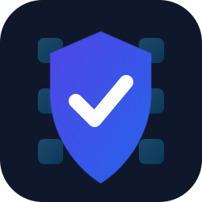

# TokenWall for VS Code

**TokenWall** is a seamless, editor-native AI spend prevention and budget governance tool for coding agents. It intercepts requests from popular AI coding extensions (like Claude Code, Cline, Roo Cline) directly from your terminal and provides intelligent proxying, prompt optimization, and budget limits.

## Features

- **Spend Limits & Budgeting**: Set daily, monthly, and per-session hard limits on your AI token usage.
- **Runaway Loop Detection**: Automatically blocks AI agents that get stuck in endless loops burning tokens without making progress.
- **Prompt Optimization**: Automatically strips useless tokens (like massive lockfiles or redundant stack traces) out of your AI prompts before they reach the provider, saving you money.
- **Smart Routing**: Routes requests to cheaper models (like switching from Claude 3.5 Sonnet to Haiku) when the task is simple enough.
- **Cost Observability**: Live status bar tracking your exact spend and how much money TokenWall has saved you today.
- **Zero Configuration Integration**: TokenWall auto-detects existing extensions like Cline or Claude Code and injects environment variables instantly. No need to change your scripts.

## Installation & Setup

1. Install TokenWall from the VS Code Marketplace.
2. In your VS Code settings, you can configure your budget limits:
   - `tokenwall.dailyLimit`: Daily limit in USD (default: $10).
   - `tokenwall.monthlyLimit`: Monthly limit in USD (default: $100).
   - `tokenwall.autoOptimize`: Enable or disable prompt compression.
3. Open a new terminal. The extension automatically intercepts AI requests by configuring environment variables (like `ANTHROPIC_BASE_URL` and `OPENAI_BASE_URL`) to point to the local TokenWall daemon.
4. Watch the TokenWall Status Bar item for real-time cost updates!

## How It Works

TokenWall runs a lightweight local Gateway Daemon on port `1984`. The VS Code extension automatically routes your terminal environment variables to this daemon. When your AI extension sends a request:
1. TokenWall estimates the input/output cost.
2. If it exceeds your budget, it blocks the request.
3. If it is safe, it performs context-analysis to compress your prompt.
4. If it detects a loop, it safely halts the agent.

For more details on the TokenWall ecosystem, check out the [GitHub Repository](https://github.com/tokenwall/tokenwall) (placeholder).

## Requirements
- VS Code ^1.75.0
- Node.js environment (for the local gateway daemon)

## Extension Settings

This extension contributes the following settings:

* `tokenwall.enableAutoInterception`: Automatically route all VS Code integrated terminal AI requests through the TokenWall proxy.
* `tokenwall.dailyLimit`: Daily budget limit in USD.
* `tokenwall.monthlyLimit`: Monthly budget limit in USD.
* `tokenwall.sessionLimit`: Per-session budget limit in USD.
* `tokenwall.hardLimitsEnabled`: Block requests immediately when budget limits are exceeded.
* `tokenwall.autoOptimize`: Automatically apply prompt optimization to reduce token bloat.

## License

[MIT](LICENSE)
